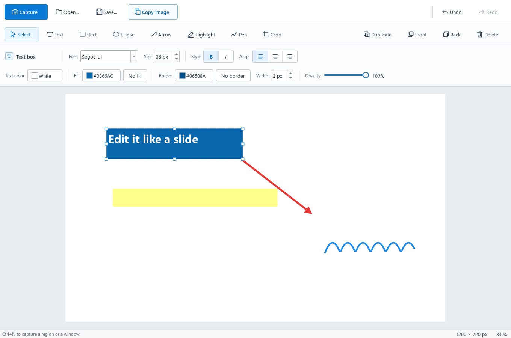

<p align="center"></p>

# Annotshot

**New here? Read the user manual: [docs/USER-MANUAL.md](docs/USER-MANUAL.md)**

Annotshot is a Windows screenshot app with PowerPoint-style editing. Capture a region or a window, then edit it like a slide: text boxes with their own text color and background fill, arrows, shapes, highlights, crop and undo. Copy the image or save a PNG in one click, and save the project to keep editing later.



Version 0.1.1 · Windows 10 and 11 first; macOS and Linux builds too · MIT licence

## Install

Annotshot comes as one zip per system on this repository's
[Releases page](../../releases). Pick the newest release, then follow the walk
for your system. `<version>` below is that release's number, for example
`0.1.1`.

### Windows (10 and 11)

1. On the [Releases page](../../releases), under **Assets**, click
   `Annotshot-<version>-windows.zip`. It lands in your **Downloads** folder.
2. Open **Downloads**, right-click `Annotshot-<version>-windows.zip` and choose
   **Extract All…**, then click **Extract**. A folder with the same name opens.
3. Open the `Annotshot` folder inside it. Keep the whole folder together:
   `Annotshot.exe` needs the files beside it.
4. Double-click `Annotshot.exe`.
5. Annotshot is not signed yet, so the first time Windows may show a blue box,
   **Windows protected your PC**. Click **More info**, then **Run anyway**.

You should see: a window titled Annotshot — Untitled

### macOS

1. On the [Releases page](../../releases), under **Assets**, click
   `Annotshot-<version>-macos.zip`. It lands in your **Downloads** folder.
2. Open **Downloads** and double-click `Annotshot-<version>-macos.zip`.
   `Annotshot.app` appears beside it.
3. Drag `Annotshot.app` into your **Applications** folder, then double-click it.
4. Annotshot is not signed by Apple yet. If macOS says it cannot check the app,
   click **Done**, open **System Settings → Privacy & Security**, scroll down
   and click **Open Anyway** next to Annotshot, then **Open**.
5. The first time you click **Capture**, macOS asks to let Annotshot record
   your screen: say yes. If the capture shows only your desktop background and
   no windows, open **System Settings → Privacy & Security → Screen & System
   Audio Recording**, switch Annotshot on, then quit Annotshot and open it again.

You should see: a window titled Annotshot — Untitled

### Linux

1. On the [Releases page](../../releases), under **Assets**, click
   `Annotshot-<version>-linux.zip`. It lands in your **Downloads** folder.
2. Unzip it (right-click → **Extract Here**, or `unzip Annotshot-<version>-linux.zip`).
   A folder named `Annotshot` appears.
3. Open a terminal in that `Annotshot` folder and make the program runnable once:

   ```
   chmod +x Annotshot
   ```

4. Start it:

   ```
   ./Annotshot
   ```

You should see: a window titled Annotshot — Untitled

Linux note: tested on X11 desktops; on Wayland, screen capture is often
restricted.

### From the source code (any system with Python 3.12)

1. Download this repository (**Code → Download ZIP**, then unzip it) or clone it.
2. Open a terminal in the repository folder and make a virtual environment with
   Qt for Python:

   ```
   python -m venv .venv
   .venv/bin/pip install PySide6-Essentials==6.12.0
   ```

   On Windows: `.venv\Scripts\pip install PySide6-Essentials==6.12.0`
3. Start the app:

   ```
   .venv/bin/python -m annotshot
   ```

   On Windows: `.venv\Scripts\python -m annotshot`, or double-click
   `Annotshot.cmd` once the virtual environment exists.

You should see: a window titled Annotshot — Untitled

## First capture

1. Click **Capture** (the blue button, top left), or press **Ctrl+N** (**⌘N** on
   a Mac). The screen freezes and dims.
2. **Drag** a box around the part you want, or **click** a window to take the
   whole window (clicking a window works on Windows; on macOS and Linux, drag).
   Press **Esc** to cancel.
3. Your capture opens in the editor. Click **Text**, click on the picture and
   type; then **Copy image** (Ctrl+C) to paste it anywhere, or **Save…** for a
   PNG or an editable `.annotshot` file.

## More

- The user manual, every button and shortcut: [docs/USER-MANUAL.md](docs/USER-MANUAL.md)
- How Annotshot compares with Snagit, ShareX, Greenshot and others:
  [docs/COMPARISON.md](docs/COMPARISON.md)

## How to build

- **Windows, by hand:** in Windows PowerShell, from the repository folder, with
  the virtual environment above plus `pip install pyinstaller`:

  ```
  powershell -ExecutionPolicy Bypass -File packaging\build-win.ps1
  ```

  It builds `dist\Annotshot\`, runs the program's headless self-check, and
  writes `dist\Annotshot-<version>-windows.zip`.
- **All three systems:** the GitHub Actions workflow
  [`.github/workflows/release.yml`](.github/workflows/release.yml) builds,
  tests and zips Windows, macOS and Linux. Push a tag `v<version>` (matching
  `annotshot/__init__.py`) and it attaches `Annotshot-<version>-windows.zip`,
  `Annotshot-<version>-macos.zip` and `Annotshot-<version>-linux.zip` to that
  release; run it by hand from the **Actions** tab for a dry run.
- **Tests:** `python -m pytest -q` (they run offscreen; no window opens).
- **Self-check:** `python -m annotshot --check` prints `Annotshot <version> OK`.

## Licence

Annotshot is MIT-licensed: see [LICENSE](LICENSE). It uses Qt for Python and
Qt 6 under the LGPL v3: see [THIRD-PARTY-NOTICES.md](THIRD-PARTY-NOTICES.md).
