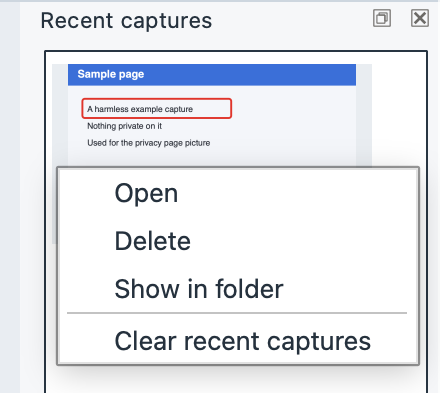
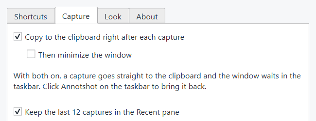

# How it stays private

Annotshot captures and edits pictures on your computer. The app has no upload feature. You choose what to paste into another app or save as a file.

### When Annotshot captures

A capture starts when you use a capture button, tray command or keyboard shortcut. Keeping Annotshot running after you close its window lets you start another capture. Leaving it running does not start a capture by itself.

### Where pictures are kept

By default, Annotshot saves each completed capture as a PNG in Recent captures. The folder is `Pictures/Annotshot/Recent` inside your home folder. The Microsoft Store edition uses `Captures/Recent` in its app data folder.

When you edit a kept capture, Annotshot saves a separate `.annotshot` file beside the PNG. The editable file includes the original picture and your marks. Someone you give that file to can see the picture underneath your marks. Annotshot does not encrypt these files.

You choose where to save exports. When Annotshot saves an editable project, Word document or PowerPoint slide, it uses a temporary file beside the destination. On macOS, capturing a live window also uses a temporary PNG.

When a capture falls outside the newest 12, Annotshot removes it from Recent if it has no saved edits. Captures with saved edits can stay longer. To stop keeping new captures, turn off **Keep the last 12 captures in the Recent pane** in **Settings… → Capture**. Pictures already there stay there.

To find a kept picture, right-click its thumbnail in the editor’s **Recent captures** pane and choose **Show in folder**. **Delete** removes that capture and its saved edits from Recent. **Clear recent captures** asks before removing them all. Copies you saved elsewhere stay where you put them.

On macOS, Show in folder opens the folder containing the capture.

### What goes on the clipboard

By default, Annotshot also copies each capture to the clipboard so you can paste it. To stop automatic copying, turn off **Copy to the clipboard right after each capture** in **Settings… → Capture**. You can still choose **Copy image** when you want to paste a marked picture.

On Windows, these two checkboxes control the clipboard copy and the saved copy separately.

### When you open a web page

Annotshot has no automatic update check, usage reporting or remote crash reporting. When you choose **Send feedback…** or **Open on GitHub**, Annotshot asks your system to open a GitHub page. It does not attach your screenshot.
